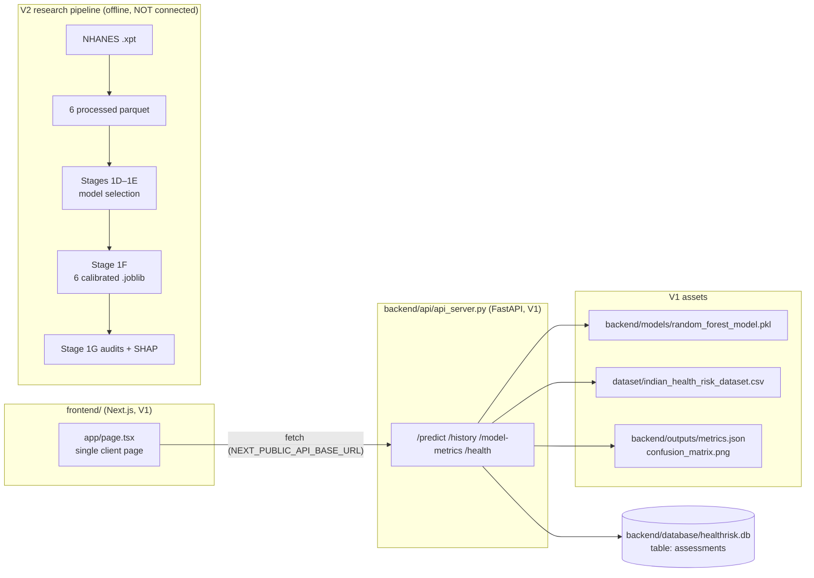
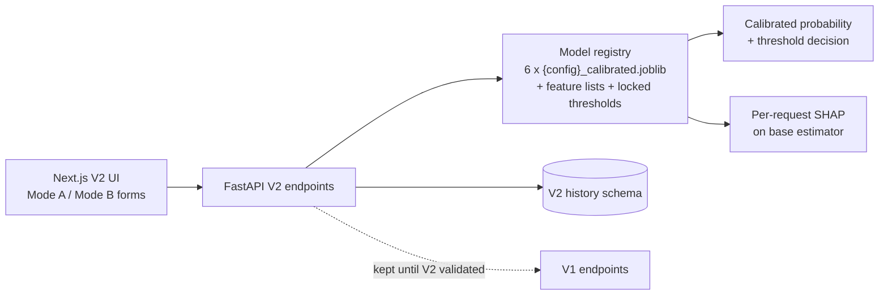

> **Note:** The maintained, sharded documentation now lives in [`README.md`](README.md) (this folder). This file is a point-in-time snapshot (2026-11-25, commit `769d40c`) and is not updated going forward.

# AI-Based Health Risk Scoring System for Preventive Healthcare — Comprehensive Project Summary

> **Document type:** Technical repository analysis and project documentation
> **Prepared:** 2026-11-25, against commit `769d40c` ("Repo cleanup audit") on branch `main`
> **Scope:** Analysis only. No application code, ML code, model artifact, dataset or configuration was modified while preparing this document.
>
> **Disclaimer:** This system is a **research prototype** for risk estimation and preventive screening support. It is **not** a clinically validated diagnostic device, and no output should be used as a medical diagnosis.

### How to read status labels

| Label | Meaning |
|---|---|
| **Implemented & verified** | Code/artifact exists and was confirmed by direct inspection and/or a documented, reproduced audit |
| **Implemented, not verified** | Code exists, but its runtime behaviour was not executed during this analysis |
| **Partially implemented** | Some pieces exist; the feature does not work end-to-end |
| **Planned** | Described in project documents; no implementation exists |
| **Not started** | Neither implementation nor detailed design exists in the repository |

---

## 1. Project Overview

The project is a final-year project that estimates the risk of chronic disease from routinely available health information and explains each estimate.

It exists in two generations that **coexist in the repository today**:

| Generation | What it is | Status |
|---|---|---|
| **V1** | Next.js + FastAPI + SQLite web app. One Random Forest **regressor**, trained on a small synthetic Indian dataset, outputs a universal 0–100 "risk score" with SHAP plots, rule-based insights, recommendations and history. | **The only running application.** Implemented, not runtime-verified here. |
| **V2** | Disease-specific, calibrated risk models for **CVD, Diabetes and Hypertension**, trained on **NHANES 2021–2023**, each in **Mode A** (basic information) and **Mode B** (basic + laboratory biomarkers): six configurations. | **ML research pipeline complete and frozen** (Stage 1G-4: CONDITIONAL PASS). **Not yet integrated** into the API or frontend. |

The key fact for any developer: **the V2 models exist as artifacts but nothing in the application loads them.** The API and UI still serve V1.

---

## 2. Problem Statement and Objectives

**Problem.** Many chronic conditions (cardiovascular disease, type 2 diabetes, hypertension) are under-diagnosed until late. Simple, explainable screening tools that use commonly available measurements can help flag people who should seek clinical assessment.

**V2 objectives** (from `PROJECT_SYSTEM_DESCRIPTION.md` and `backend/ml/data/MODEL_V2_DESIGN.md`):

1. Predict **independent, disease-specific probabilities** for CVD, Diabetes and Hypertension.
2. Support two input levels: **Mode A** (no lab tests) and **Mode B** (adds blood biomarkers).
3. Produce **calibrated probabilities** and **threshold-based screening decisions** tuned for screening (sensitivity and specificity both ≥ 0.65 where possible).
4. Provide **SHAP-based explanations** for individual predictions.
5. Keep research quality: leakage controls, fixed splits, untouched test evaluation, and independent audits.

**Non-goals:** clinical diagnosis; a single universal health score (the V1 0–100 score is **not** part of the V2 design).

---

## 3. Project Evolution: V1 to V2

### 3.1 What V1 does

| Aspect | V1 implementation (verified in code) |
|---|---|
| Data | `dataset/indian_health_risk_dataset.csv` (~15.6 KB, synthetic) |
| Inputs | 14 fields: age, gender, BMI, systolic/diastolic BP, cholesterol, smoking, alcohol, physical activity, family history, heart rate, SDNN HRV, RMSSD HRV, SpO₂ |
| Model | sklearn `Pipeline` (`preprocessor` + `model`) with a **RandomForestRegressor**, at `backend/models/random_forest_model.pkl` |
| Output | Continuous "risk score" intended to be 0–100, banded Low (0–34) / Medium (35–69) / High (70–100) |
| Explainability | `shap.TreeExplainer` on the regressor, with summary, bar and waterfall plots as base64 PNG |
| Extras | Rule-based insights and recommendations; SQLite history |
| Stored metrics | `backend/outputs/metrics.json` (MAE 11.26, RMSE 13.12, R² 0.786; accuracy 0.667, F1 0.666) |

### 3.2 Limitations that motivated V2

- **Synthetic, very small dataset:** no real population signal and limited external validity.
- **Universal score:** a single 0–100 number mixes different diseases, has no probabilistic meaning, and cannot be calibrated or given a clinically interpretable threshold.
- **Regression on a constructed score** rather than classification of a defined outcome.
- **Wearable-style inputs** (HRV, SpO₂) not available in a population survey with confirmed outcomes.
- No calibration, threshold rationale, leakage control or formal held-out evaluation.

### 3.3 What changed in V2

| V1 | V2 | Rationale |
|---|---|---|
| Synthetic Indian dataset | NHANES 2021–2023 (CDC, US) | Real, documented, nationally representative survey with exam and lab data |
| One 0–100 score | Three disease-specific probabilities | Each disease has its own definition, prevalence and risk factors |
| One input form | Mode A / Mode B | Usable without lab tests (A), with higher discrimination when labs exist (B) |
| One model | Six separately selected models | The best algorithm differed by disease and mode |
| Uncalibrated output | Sigmoid (Platt) calibration + locked thresholds | Probabilities must be meaningful; decisions need a justified cut-off |
| Ad hoc evaluation | 70/15/15 stratified splits, test held out for final evaluation, Stage 1G audits | Research-grade evidence |

### 3.4 Research-quality controls added

- Per-target **leakage exclusion lists** (target-defining and treatment-proxy fields removed).
- **Survey metadata excluded** from predictors.
- Fixed, persisted **participant-level split files** (seed 42, stratified).
- Hyperparameter search by **cross-validation on the development set**.
- Calibration method and thresholds chosen on **validation data only** (out-of-fold).
- Four **Stage 1G audits** including independent metric reproduction.

### 3.5 What remains from V1

Everything in the running application (API, UI, database) is V1. See Sections 16–18 and 20.

---

## 4. Current Technology Stack

| Layer | Technology | Source |
|---|---|---|
| Frontend | Next.js `^16.2.7` (App Router), React 18.3.1, TypeScript 5.5.4, plain global CSS | `frontend/package.json` |
| Backend API | FastAPI, Uvicorn, Pydantic (via FastAPI) | `backend/api/api_server.py` |
| Secondary UI | Streamlit dashboard | `backend/api/app.py` |
| Database | SQLite via Python's built-in `sqlite3` (**no SQLAlchemy, no ORM, no migrations**) | `backend/database/database.py` |
| ML | scikit-learn, XGBoost (≥ 3.1.0), SHAP, pandas, NumPy, joblib, PyArrow (≥ 14.0.0), matplotlib | `backend/requirements.txt` |

`backend/requirements.txt` (complete): `pandas, numpy, scikit-learn, joblib, matplotlib, shap, streamlit, fastapi, uvicorn, xgboost>=3.1.0, pyarrow>=14.0.0`. Most packages are **unpinned**. The exact scikit-learn version used to train the models is not recorded in the requirements (Stage 1F uses `FrozenEstimator`, which needs scikit-learn ≥ 1.6; `repository_cleanup_final.md` reports 1.9.0 installed).

---

## 5. Repository Structure and Important Files

```
AI-Health-Risk-Scoring-System/
├── PROJECT_SYSTEM_DESCRIPTION.md        # Canonical V2 system description
├── README.md                            # Stale V1-only readme
├── repository_cleanup_audit.md          # Cleanup audit (pre-cleanup)
├── repository_cleanup_final.md          # Cleanup execution report
├── shap_compute.py                      # Stage 1G-3 SHAP computation (repo root)
├── shap_plot_figure3.py                 # Stage 1G-3 figure generation (repo root)
├── shap_global_values.{csv,json}        # Global SHAP results
├── fig3_global_shap_feature_importance.{png,pdf,svg}
├── shap_summary_plot.png, shap_waterfall_plot.png
├── dataset/indian_health_risk_dataset.csv   # V1 runtime dataset (KEEP)
├── docs/
│   ├── legacy_v1/                       # 6 archived V1 docs + README
│   └── PROJECT_COMPREHENSIVE_SUMMARY.md # This document
├── frontend/                            # Next.js V1 UI
│   └── app/{page.tsx, layout.tsx, globals.css, icon.svg}
└── backend/
    ├── requirements.txt
    ├── api/{__init__.py, api_server.py, app.py}
    ├── database/{database.py, healthrisk.db}
    ├── models/random_forest_model.pkl   # V1 model (KEEP)
    ├── outputs/
    │   ├── metrics.json, confusion_matrix.png   # V1 (KEEP)
    │   ├── model_v2_baseline/           # Stage 1D outputs
    │   └── model_v2_xgboost_baseline/   # Stage 1E-1 outputs
    └── ml/
        ├── *.py                         # V1 helpers (feature_engineering, risk_interpreter, shap_explainer, ...)
        ├── scripts/                     # V2 pipeline scripts (Stages 1A–1F)
        ├── data/{raw, interim, processed}/
        └── evaluation/{stage_1e2, stage_1e3, stage_1f, stage_1g}/
```

---

## 6. Overall System Architecture

### 6.1 Current architecture (implemented: V1 application + separate V2 research pipeline)



### 6.2 Proposed V2 architecture (planned, not implemented)



---

## 7. Dataset Sources and NHANES Processing

### 7.1 Raw sources

`backend/ml/data/raw/nhanes_2021_2023/` holds 16 NHANES August 2021–August 2023 (`_L`) SAS transport files:

| Domain | Files |
|---|---|
| Demographics | DEMO |
| Examination | BMX (body measures), BPXO (oscillometric BP) |
| Questionnaire | BPQ, SMQ, ALQ, PAQ, DIQ, MCQ |
| Laboratory | GHB (HbA1c), GLU (fasting glucose), TCHOL, HDL, TRIGLY, BIOPRO, CBC |

`backend/ml/data/raw/icmr_indiab/` (`meta.pdf`, `sample.dta`) is present but **not used** by the V2 pipeline.

### 7.2 Pipeline scripts (`backend/ml/scripts/`)

| Script | Role |
|---|---|
| `nhanes_loader.py` | Reads `.xpt` files |
| `nhanes_harmonizer.py` | Age filter, SEQN merge, recoding, feature construction |
| `nhanes_targets.py` | Target construction |
| `nhanes_quality_checks.py` | Feature lists, per-target exclusions, QC |
| `build_nhanes_dataset.py` | Orchestration; writes interim and processed outputs |
| `audit_datasets.py`, `generate_feature_matrix.py` | Dataset audit / feature matrix |

### 7.3 Extraction, merge and inclusion

- **Age restriction:** `RIDAGEYR >= 20` (`nhanes_harmonizer.py:263`), applied to DEMO **before** any join: 11,933 → **7,809** participants.
- **Merge:** each component is **left-joined on `SEQN`** in sequence with an assertion that the row count is unchanged (`nhanes_harmonizer.py:271-293`).
- **Recoding:** NHANES "refused/don't know" codes (7/9, 77/99, 777/999, 7777/9999 as applicable) → NaN (`:52-73`, `:188-206`). Smoking, alcohol and activity variables are recoded into ordinal features (`:80-158`).
- **Blood pressure:** `mean_sbp`, `mean_dbp` and `mean_pulse` are skip-NaN means of three oscillometric readings (`:161-185`).
- **Per-target exclusion:** at modelling time, rows with a missing target are dropped, giving CVD 7,807, Diabetes 7,806 and Hypertension 7,800 modelled participants.

### 7.4 Missing values (actual behaviour)

- **No dataset-level imputation.** Processed parquet files keep NaN.
- **Logistic Regression and Random Forest:** `SimpleImputer(strategy="median")` (plus `StandardScaler` for LR) inside the sklearn `Pipeline`, so it is fitted only on the training folds (`optimize_models.py:251-256`, `optimize_random_forest.py:180-185`).
- **HistGradientBoosting and XGBoost:** handle NaN natively.
- `DATASET_MANIFEST.md` lines 94-96 describe a planned `IterativeImputer`; this was **never implemented** (stale documentation).

### 7.5 Outputs

| Location | Contents |
|---|---|
| `backend/ml/data/interim/nhanes_2021_2023_merged.parquet` | Merged harmonized cohort |
| `backend/ml/data/interim/audit/` | Cleaning log, target construction JSON, QC files |
| `backend/ml/data/processed/nhanes_2021_2023/` | `nhanes_{cvd,diabetes,hypertension}_mode_{a,b}.parquet`, `DATASET_MANIFEST.md` |
| `.../splits/` | `cvd_splits.csv`, `diabetes_splits.csv`, `hypertension_splits.csv` |

**Row counts:** all six parquet files contain **7,809** rows according to `DATASET_MANIFEST.md` §10 and the Stage 1G-4 audit §3. *This analysis could not re-read the parquet files* (pandas is not installed in the local Python interpreters). The split CSV totals (7,807 / 7,806 / 7,800 = 7,809 minus missing targets) were counted directly and are consistent.

---

## 8. Target Definitions and Leakage Prevention

### 8.1 Targets (`backend/ml/scripts/nhanes_targets.py`)

| Target | Definition (positive if any condition is met) | Missing rule | Positives |
|---|---|---|---|
| **CVD** (`:89-109`) | Any of `MCQ160B` (CHF), `MCQ160C` (CHD), `MCQ160D` (angina), `MCQ160E` (heart attack), `MCQ160F` (stroke) == 1 | 0 if at least one answered and none positive; NaN if all missing (2) | 982 (12.58%) |
| **Diabetes** (`:138-167`) | `hba1c >= 6.5`, `fasting_glucose (LBXGLU) >= 126`, `DIQ010 == 1` (diagnosed), `DIQ050 == 1` (insulin), `DIQ070 == 1` (diabetes pills) | 3 missing | 1,385 (17.74%) |
| **Hypertension** (JNC7, `:192-205`) | `mean_sbp >= 140`, `mean_dbp >= 90`, or `BPQ020 == 1` (told has high BP) | 9 missing | 3,331 (42.71%) |

CVD is **self-reported prior diagnosis**, so the CVD model estimates the probability of *having* a history of CVD, not future incidence. Diabetes and hypertension combine measured values with self-report.

### 8.2 Leakage exclusions (`nhanes_quality_checks.py:80-122`)

| Target | Fields excluded from predictors |
|---|---|
| CVD | `MCQ160B–F`, `DIQ050`, `DIQ070`, `BPQ101D` (treatment proxies) |
| Diabetes | `hba1c`, `fasting_glucose`, `DIQ010`, `DIQ050`, `DIQ070`, `BPQ101D` |
| Hypertension | `mean_sbp`, `mean_dbp`, `BPQ020`, `BPQ101D` |

### 8.3 Survey metadata

`SEQN`, `WTINT2YR`, `WTMEC2YR`, `WTSAF2YR`, `SDMVSTRA` and `SDMVPSU` are **kept in the parquet files** (`build_nhanes_dataset.py:118-123`) but **removed from predictors** via `EXCLUDE_COLS` (`benchmark_models.py:78`, `optimize_models.py:92`, `calibrate_and_optimize_thresholds.py:81-83`). **Survey weights are not used** in training, calibration or evaluation, so the metrics are **unweighted sample estimates**, not population-weighted.

### 8.4 Known weakness in the Stage 1F guard

The secondary target-exclusion list in `calibrate_and_optimize_thresholds.py:85-99` uses raw-style names (e.g. `lbxglu`, `bpa_mean_sbp`) that do not match the harmonized column names (`fasting_glucose`, `mean_sbp`). This is **not an active leak**: the processed datasets and the Stage 1D/1E assertions already exclude these columns, and the final feature lists (Section 9) contain none of them. But the 1F guard itself would not catch a regression.

---

## 9. Mode A and Mode B Feature Design

**Mode A base (13 features):** `age`, `gender`, `education_level`, `poverty_income_ratio`, `bmi`, `waist_circumference`, `mean_sbp`, `mean_dbp`, `mean_pulse`, `smoking_status`, `alcohol_frequency`, `physical_activity_level`, `sedentary_minutes`.

**Mode B laboratory additions (16):** `hba1c`, `fasting_glucose`, `total_cholesterol`, `hdl_cholesterol`, `triglycerides`, `ldl_cholesterol`, `serum_creatinine`, `blood_urea_nitrogen`, `serum_uric_acid`, `alt_enzyme`, `ast_enzyme`, `hemoglobin`, `wbc_count`, `platelet_count`, `rdw`, `serum_albumin`.

| Configuration | # Features | Composition |
|---|---:|---|
| CVD A | 13 | Mode A base |
| CVD B | 29 | Mode A base + 16 labs |
| Diabetes A | 13 | Mode A base |
| Diabetes B | 27 | Mode A base + 16 labs − `hba1c`, `fasting_glucose` |
| Hypertension A | 11 | Mode A base − `mean_sbp`, `mean_dbp` |
| Hypertension B | 27 | 11 + 16 labs |

**Authoritative feature order:** there is **no separate feature-manifest file**. The ordered feature list for each configuration is stored in the `features` key of each record in `backend/ml/evaluation/stage_1f/stage_1f_results.json` (written at `calibrate_and_optimize_thresholds.py:563`). V2 inference must use that order.

Note that V2 features differ entirely from V1's (no HRV, SpO₂ or family history; adds waist, income ratio, education, sedentary time and labs). V1 form data cannot be fed to V2 models.

---

## 10. ML Training and Model Selection

| Stage | Script | What happened |
|---|---|---|
| **1D** baseline | `benchmark_models.py` | LR, class-balanced LR, RF (100 trees), balanced RF, HGB, balanced HGB; fit on train, ranked by validation ROC-AUC then PR-AUC (`:91-115`, `:394`). Outputs in `backend/outputs/model_v2_baseline/`. Also **creates the split files**. |
| **1E-1** | `benchmark_xgboost.py` | XGBoost baseline. Outputs in `backend/outputs/model_v2_xgboost_baseline/`. |
| **1E-2** | `optimize_models.py` | `RandomizedSearchCV(n_iter=40, scoring="roc_auc", random_state=42)` with `StratifiedKFold(5, shuffle=True, random_state=42)` on the **development set (train + validation)** for LR, HGB and XGB (search spaces `:150-211`). Within a configuration, winner by mean CV ROC-AUC (`:492`). |
| **1E-3** | `optimize_random_forest.py` | Same search design for RF (spaces `:112-140`, incl. `balanced` / `balanced_subsample`). |
| **1F** | `calibrate_and_optimize_thresholds.py` | Loads the selected optimized model per configuration (`:102-163`), refits, calibrates and sets thresholds (Section 12). |

### Final selections

| Configuration | Final model | Notable hyperparameters (verified) | Source artifact |
|---|---|---|---|
| CVD A | Optimized Random Forest | 500 trees, max_depth 8, max_features `log2` | `evaluation/stage_1e3/models/cvd_mode_a_rf_v2_optimized.joblib` |
| CVD B | Optimized Random Forest | 800 trees, max_depth 8, max_features 0.5 | `evaluation/stage_1e3/models/cvd_mode_b_rf_v2_optimized.joblib` |
| Diabetes A | HistGradientBoosting | see `stage_1e2_results.json` | `evaluation/stage_1e2/models/diabetes_mode_a_hist_gradient_boosting_v2_optimized.joblib` |
| Diabetes B | XGBoost | see `stage_1e2_results.json` | `evaluation/stage_1e2/models/diabetes_mode_b_xgboost_v2_optimized.joblib` |
| Hypertension A | Logistic Regression | median imputer + scaler + LR | `evaluation/stage_1e2/models/hypertension_mode_a_logistic_regression_v2_optimized.joblib` |
| Hypertension B | Optimized Random Forest | 800 trees, max_depth 8, max_features 0.5 | `evaluation/stage_1e3/models/hypertension_mode_b_rf_v2_optimized.joblib` |

(Paths relative to `backend/ml/`. Full hyperparameters are in `stage_1e2_results.json` and `random_forest_optimization_results.json`; they are not repeated here to avoid transcription error.)

### ⚠️ Methodological caveat: test set used in cross-stage selection

Comparisons **between** stages (1D vs 1E-2 and 1E-2 vs optimized RF) use **test-set** ROC-AUC. For example, `optimize_models.py` computes `delta_vs_1d` from `opt_test["roc_auc"]` and issues "OPTIMIZED MODEL IS BETTER / KEEP STAGE 1D MODEL" recommendations from it, and `optimize_random_forest.py:392-402` and the 1E-3 report §4 do the same. So the **choice of model family** was informed by the test set before Stage 1F. This conflicts with the "test set evaluated exactly once" statements in the Stage 1F and 1G-4 reports, and **none of the Stage 1G audits flag it**. The differences involved are small, but the final test metrics should be described as **slightly optimistic** and this should be disclosed in any publication.

---

## 11. Data Splitting and Reproducibility

- **Generated in:** `benchmark_models.py:254-281` (Stage 1D).
- **Method:** for each disease, the Mode A dataset minus missing targets → `train_test_split(test_size=0.30, random_state=42, stratify=target)` → remaining 30% split 50/50 (same seed, stratified) = **70 / 15 / 15**.
- **One split file per disease, shared by Mode A and Mode B**, so both modes are evaluated on the same participants.
- **Columns:** `SEQN`, `target_<disease>`, `split` (`train` / `validation` / `test`).

| Disease | Train (pos) | Validation (pos) | Test (pos) | Total |
|---|---|---|---|---|
| CVD | 5,464 (687) | 1,171 (147) | 1,172 (148) | 7,807 |
| Diabetes | 5,464 (969) | 1,171 (208) | 1,171 (208) | 7,806 |
| Hypertension | 5,460 (2,332) | 1,170 (500) | 1,170 (499) | 7,800 |

(Counted directly from the CSVs. Stage 1G-1 confirmed zero participant overlap between splits.)

**Seeds:** 42 throughout (splits, CV folds, randomized search, LinearExplainer background sample).

**Reproducibility limits:** unpinned dependencies; no recorded library versions for the serialized models; report hyperlinks point to another machine (`C:/Users/sunny/...`).

---

## 12. Calibration and Threshold Optimization

Implemented in `backend/ml/scripts/calibrate_and_optimize_thresholds.py`:

1. **Base model refit on training data only.** The Stage 1E estimator is cloned and refit on the train split (`:402-404`).
2. **Calibration comparison on validation (OOF).** Raw vs sigmoid vs isotonic, compared with 5-fold out-of-fold CV over the validation predictions (`:279-307`). Sigmoid = logistic regression on the logit with `C=1e5`.
3. **Selection rule** (`:427-447`): isotonic only if it beats sigmoid by > 0.001 Brier **and** > 0.005 ECE; otherwise sigmoid if it is not worse than raw on Brier or better on ECE; otherwise raw. **Sigmoid was selected for all six.**
4. **Threshold sweep** (`:476-500`) over OOF validation probabilities, 0.05–0.95 in 91 steps: among thresholds with **sensitivity ≥ 0.65 and specificity ≥ 0.65**, choose the maximum **Youden's J** (ties → F2, then F1). If none qualify, fall back to the global maximum of Youden's J.
5. **Final calibrator refit** (`:514-520`): `CalibratedClassifierCV(FrozenEstimator(base), method="sigmoid").fit(X_val, y_val)`.
6. **Serialization** (`:544-548`): the **complete calibrated estimator** is saved with both joblib and pickle to `backend/ml/evaluation/stage_1f/models/{config}_calibrated.{joblib,pkl}`.
7. **Single final evaluation** on the test split.

### Locked thresholds (verified in `stage_1f_comparison.csv`)

| Configuration | Model | Calibration | Threshold |
|---|---|---|---:|
| CVD A | Optimized RF | Sigmoid | **0.13** |
| CVD B | Optimized RF | Sigmoid | **0.15** |
| Diabetes A | HistGradientBoosting | Sigmoid | **0.15** |
| Diabetes B | XGBoost | Sigmoid | **0.17** |
| Hypertension A | Logistic Regression | Sigmoid | **0.41** |
| Hypertension B | Optimized RF | Sigmoid | **0.52** |

### Inference rule

`model.predict_proba(X)[:, 1]` on the loaded `{config}_calibrated.joblib` **already returns the calibrated probability**. Applying another sigmoid/Platt step would calibrate twice and is wrong. The positive/negative decision is `probability >= locked_threshold`. Do **not** use `model.predict()`, which applies a 0.5 cut-off.

---

## 13. Final Test Performance

Source of truth: `backend/ml/evaluation/stage_1f/stage_1f_comparison.csv` (and `stage_1f_results.json`). **All 60 values below were cross-checked against the CSV and match exactly.** Binary metrics are at the locked threshold. Test n = 1,172 / 1,172 / 1,171 / 1,171 / 1,170 / 1,170.

| Configuration | ROC-AUC | PR-AUC | Brier | ECE | Sensitivity | Specificity | Precision | NPV | F1 | Bal. Acc. |
|---|---:|---:|---:|---:|---:|---:|---:|---:|---:|---:|
| CVD A | 0.8137 | 0.4159 | 0.0912 | 0.0125 | 0.6824 | 0.7803 | 0.3098 | 0.9444 | 0.4262 | 0.7314 |
| CVD B | 0.8218 | 0.4340 | 0.0906 | 0.0368 | 0.6081 | 0.8438 | 0.3600 | 0.9371 | 0.4523 | 0.7259 |
| Diabetes A | 0.7957 | 0.4348 | 0.1222 | 0.0250 | 0.8173 | 0.6397 | 0.3288 | 0.9419 | 0.4690 | 0.7285 |
| Diabetes B | 0.8162 | 0.4793 | 0.1203 | 0.0470 | 0.6202 | 0.8100 | 0.4135 | 0.9080 | 0.4962 | 0.7151 |
| Hypertension A | 0.7662 | 0.6541 | 0.1946 | 0.0331 | 0.7615 | 0.6647 | 0.6281 | 0.7894 | 0.6884 | 0.7131 |
| Hypertension B | 0.7731 | 0.6898 | 0.1916 | 0.0465 | 0.6253 | 0.7511 | 0.6514 | 0.7294 | 0.6380 | 0.6882 |

### Mode A vs Mode B trade-offs

- **Mode B improves ranking for all three diseases**: ROC-AUC +0.008 (CVD), +0.021 (Diabetes), +0.007 (Hypertension); PR-AUC also improves for all three. Brier improves slightly for all three.
- **Mode B is not universally better:**
  - **ECE is worse** in Mode B for all three diseases (calibration on the test set is less tight).
  - **Sensitivity drops** at the locked thresholds: CVD 0.682 → 0.608, Diabetes 0.817 → 0.620, Hypertension 0.762 → 0.625, with specificity rising correspondingly. These are different operating points, not just better models.
  - **Balanced accuracy is lower** in Mode B for all three diseases.
  - CVD B and Hypertension B sensitivities (0.608, 0.625) fall **below the 0.65 target** used in threshold selection; the constraint was met on validation but did not hold on test.
- **Low precision for CVD and Diabetes** (0.31–0.41) reflects low prevalence: most positive flags are false positives, which is expected for a screening operating point with high NPV (0.91–0.94).
- For a screening use case, **Mode A can be preferable** when sensitivity matters most; Mode B gives better-ranked probabilities.

---

## 14. SHAP Explainability Methodology

**Scripts (repo root, not under `backend/ml`):** `shap_compute.py`, `shap_plot_figure3.py`.

| Aspect | Implementation |
|---|---|
| Model explained | The **base estimator** extracted from `calibrated_classifiers_[0]` and unwrapped from `FrozenEstimator` (`shap_compute.py:149-187`). For Pipeline models, `est[:-1]` transforms X and `est[-1]` is explained (`:226-247`). |
| Explainers | `shap.TreeExplainer` for RF, HGB and XGB (`:267-274`); `shap.LinearExplainer` for Hypertension A LR with a 200-row background sampled from the test set, `random_state=42` (`:275-279`). |
| Data | Held-out **test split** only (`:190-223`). No retraining. |
| Artifacts | Root: `shap_global_values.csv/.json`, `fig3_global_shap_feature_importance.{png,pdf,svg}`, `shap_summary_plot.png`, `shap_waterfall_plot.png`. Also `backend/ml/evaluation/stage_1g/figures/` and `stage_1g_shap_analysis.json`, `STAGE_1G_SHAP_ANALYSIS.md`. |
| Examples | Waterfall: SEQN 130670 (Diabetes B, P = 0.539); beeswarm: 300 test participants (per report). |

### Interpretation rules

- SHAP values are **additive in the base model's output space** (log-odds/margin for LR, HGB and XGB; the RF's probability output before calibration). They are **not** additive contributions to the **calibrated** probability, and must **not** be shown as "+X percentage points" or "+X%".
- SHAP describes **model behaviour, not causal medical effects.** Correlated features (e.g. BMI and waist) share attribution arbitrarily.
- The precomputed SHAP files describe **NHANES test participants**. They must **never** be presented as explanations of an application user. Live explanations must be computed per submitted input (Section 19).

---

## 15. Stage 1G Audits and Research Readiness

Reports in `backend/ml/evaluation/stage_1g/`.

| Audit | Report | Verdict | Checked | Issues |
|---|---|---|---|---|
| **1G-1** Final Model Integrity | `STAGE_1G_INTEGRITY_AUDIT.md` (+ JSON) | **PASS** | Artifacts load; architectures; feature parity; split disjointness; sigmoid refit on validation; thresholds vs sweeps; test metrics recomputed within 1e-4; leakage; V1 contamination | None |
| **1G-2** Performance & Mode A/B | `STAGE_1G_PERFORMANCE_ANALYSIS.md` (+ JSON) | **PASS** | Consolidated metrics, calibration comparison, Mode A/B trade-offs, figures | None blocking |
| **1G-3** SHAP Interpretability | `STAGE_1G_SHAP_ANALYSIS.md` (+ JSON) | **PASS / LOCKED** | Explainer choice, base-model extraction, global and local explanations | Missing IEEE SHAP figures, **resolved** (regenerated). Limitations noted: margin space, correlated features, LinearExplainer background. |
| **1G-4** Final Research Readiness | `STAGE_1G-4_FINAL_RESEARCH_READINESS_AUDIT.md` | **CONDITIONAL PASS** (line 8): zero methodological blockers, pipeline frozen & verified | Provenance, targets, leakage, splits, artifacts, calibration, thresholds, metric reproduction, Mode A/B, SHAP fidelity, paper claims, reproducibility | 4 non-blocking issues (below) |

**1G-4 non-blocking issues (§18):**

| ID | Issue | Current status |
|---|---|---|
| ISSUE-1 | `requirements.txt` lacked xgboost and pyarrow | **Resolved**: now lists `xgboost>=3.1.0`, `pyarrow>=14.0.0` |
| ISSUE-2 | Stale V1 material in `docs/` | **Largely resolved** by archiving to `docs/legacy_v1/`; `README.md` remains V1-only |
| ISSUE-3 | UI mockup shows SHAP as "+14.2%" | **Open.** Must not be carried into V2 UI |
| ISSUE-4 | Figures 1, 2 and 5 exist only as ASCII | **Open** (publication concern only) |

"Conditional pass" means the **research pipeline** is fit to be frozen and reported. It is **not** clinical validation: there is no external validation, no prospective study, no regulatory review, and the cohort is US-based.

### Report inconsistencies found during this analysis (not flagged by the audits)

1. Test-set use in cross-stage model-family selection (Section 10).
2. 1G-3 report §4 gives cohort totals 7,816 / 7,810 / 7,804; the actual totals are **7,807 / 7,806 / 7,800**.
3. 1G-3 report §3 calls the calibrator "prefit"; code uses `FrozenEstimator`.
4. 1G-4 §7 lists Hypertension A imputation as `SimpleImputer()`; code uses `strategy="median"`.
5. 1G-4 §8 says isotonic had "higher Brier" in every case; the actual selection rule is margin-based (per-config values not re-verified here).
6. `DATASET_MANIFEST.md`: line 6 still says "Awaiting Stage 1D"; lines 94-96 describe an IterativeImputer that was never used; line 108 says survey weights would be used in calibration, but calibration is unweighted.

None of these change the reported test metrics, which were reproduced exactly.

---

## 16. Backend Architecture and API Endpoints

**Entry point:** `backend/api/api_server.py`, `app = FastAPI(title="AI Health Risk API", version="1.0")` (line 73). Run with `python -m uvicorn backend.api.api_server:app --reload` (README). There are **no separate router modules**; `backend/api/__init__.py` is empty.

`backend/api/app.py` is a **Streamlit** dashboard (not an API). It imports `api_server` (so importing it also creates DB tables). Known bug: line 512 calls `generate_insights(positive, negative)` without the required `payload` argument, so its predict path raises `TypeError`, which is caught and shown with `st.error`.

### Endpoints (all V1) — *Implemented, not runtime-verified*

| Method | Path | Function (line) | Behaviour |
|---|---|---|---|
| GET | `/` | `root` (174) | `{"status":"ok"}` |
| GET | `/health` | `health_check` (179) | `{"status":"ok"}` |
| POST | `/predict` | `predict` (262) | V1 prediction (below) |
| GET | `/history` | `history` (182) | Latest 20: `{id, age, risk_score, risk_level, created_at}`, timestamps converted UTC → Asia/Kolkata |
| DELETE | `/history/{assessment_id}` | `delete_single_assessment` (215) | 404 if not found |
| DELETE | `/history` | `delete_all_history` (227) | Clears all |
| GET | `/model-metrics` | `get_model_metrics` (234) | V1 `metrics.json` + base64 `confusion_matrix.png`; 404 if missing |

### Schemas (in `api_server.py`)

- `PredictionInput` (37-51): `age` int 18–80, `gender` str, `bmi` 15–45, `systolic_bp` 90–200, `diastolic_bp` 60–130, `cholesterol_mg_dl` 120–320, `smoking`, `alcohol_consumption`, `physical_activity`, `family_history` (str), `heart_rate_bpm` 50–130, `sdnn_hrv` 10–140, `rmssd_hrv` 10–140, `spo2` 90–100.
- `PredictionResponse` (59-68): `risk_score`, `risk_level`, `positive_contributors` / `negative_contributors` (`{feature, value}`), `insights`, `recommendations`, `summary_plot`, `bar_plot`, `waterfall_plot` (base64 PNG).

### V1 `/predict` flow

1. `_prepare_input_df` builds a DataFrame using `FEATURE_COLUMNS` (13 columns, `backend/ml/feature_engineering.py:6-20`). **`gender` is accepted and stored but not used by the model.**
2. `_get_pipeline()` (lazy, `lru_cache`) loads `backend/models/random_forest_model.pkl` via `backend/ml/shap_explainer.load_model` (joblib).
3. `pipeline.predict(...)` returns the regressor output as `risk_score`. **It is not clamped to 0–100.**
4. `classify_risk` (`backend/ml/risk_interpreter.py`) uses integer bands; non-integer values in gaps (e.g. 34.5) or out-of-range values return `"Unknown"`.
5. `save_assessment` writes the row **before** SHAP runs.
6. SHAP: `TreeExplainer` on the pipeline's `model` step; top 6 contributors; rule-based `generate_insights`; `_generate_recommendations` (fixed thresholds); summary and bar plots from a cached 200-row reference sample of the V1 CSV, plus a per-request waterfall.

### Configuration

- **CORS** (74-80): origins `http://localhost:3000`, `http://127.0.0.1:3000`; credentials, all methods and headers.
- **Environment variables:** none in the backend; all paths are hard-coded relative to the project root.
- **Startup:** no `lifespan`/`on_event`; `create_tables()` runs at import (line 71).
- **Errors:** Pydantic 422 for validation; `/predict` catches all exceptions → 500 with `str(exc)`.

### Minor issues observed

- Deprecated Pydantic v2 `payload.dict()` usage (lines 98, 282).
- Debug `print(feature_names)` (line 278); debug prints in `database.py`.
- `generate_insights` checks for `"moderate"` while the UI sends `"Medium"`; SpO₂ text contains mojibake.
- `ZoneInfo("Asia/Kolkata")` may require `tzdata` on Windows (not in requirements).

---

## 17. Frontend Architecture and User Flows

*All V1. Implemented, not runtime-verified.*

- **Framework:** Next.js App Router; the only route is `/` (`frontend/app/page.tsx`, a single `"use client"` component `Home`). There is no components directory, no auth, and no UI/chart/form libraries.
- **Layout:** `app/layout.tsx` (Manrope + Space Grotesk fonts; title "AI Health Risk Dashboard").
- **Styling:** `app/globals.css` (plain CSS with custom properties, dark theme).
- **API base:** `process.env.NEXT_PUBLIC_API_BASE_URL || "http://127.0.0.1:8000"` (line 5); raw `fetch`.

| Flow | Endpoint | Implementation |
|---|---|---|
| Assessment form | — | Sliders/number inputs with HTML min/max only (lines 277-534); 3 presets (default/high/low) |
| Predict | `POST /predict` | Shows `risk_score.toFixed(2)` as "Score (0-100)", a clamped progress bar and a risk pill |
| Explanation | (in predict response) | Contributor chips (names only), insight text, three SHAP PNGs |
| Model metrics | `GET /model-metrics` | V1 regression + classification metrics, confusion matrix |
| History | `GET/DELETE /history` | Table with per-row delete and clear-all |

**V1 assumptions to remove in V2:** continuous 0–100 score; Low/Medium/High strings; single "cardiovascular" model; HRV/SpO₂ inputs; regression metrics panel; one score per history row.

**V2 frontend code:** none exists.

**Build state:** `frontend/node_modules/` and `frontend/.next/` are **absent**, so `npm install` is required before running.

---

## 18. Database Design and Persistence

- **Engine:** Python `sqlite3` (no SQLAlchemy, no ORM models, no migrations).
- **File:** `backend/database/healthrisk.db` (path set in `backend/database/database.py:5`).
- **Initialization:** `create_tables()` → `CREATE TABLE IF NOT EXISTS`, run at API import.

**Table `assessments`** (the only table):

| Column | Type |
|---|---|
| `id` | INTEGER PK AUTOINCREMENT |
| `age`, `bmi`, `systolic_bp`, `diastolic_bp`, `cholesterol_mg_dl`, `heart_rate_bpm`, `sdnn_hrv`, `rmssd_hrv`, `spo2` | numeric |
| `gender`, `smoking`, `alcohol_consumption`, `physical_activity`, `family_history` | TEXT |
| `risk_score` | REAL |
| `risk_level`, `model_version` (hard-coded `"RF_v1"`) | TEXT |
| `created_at` | TIMESTAMP DEFAULT CURRENT_TIMESTAMP |

Functions: `save_assessment`, `get_assessment_history(limit=20)`, `delete_assessment`, `delete_all_assessments`. There are no users and no relationships.

**V2 schema:** **not started.** A V2 schema would need disease, mode, the V2 feature set (many fields nullable for Mode A), the probability, the threshold used, the decision and model version, and must not overwrite V1 rows.

---

## 19. Model Artifacts and Inference Workflow

### Authoritative V2 artifacts (`backend/ml/evaluation/stage_1f/`)

| Artifact | Purpose |
|---|---|
| `models/{cvd,diabetes,hypertension}_mode_{a,b}_calibrated.joblib` | **Final calibrated estimators (use these)** |
| `models/*_calibrated.pkl` | Pickle duplicates of the same objects |
| `stage_1f_results.json` | Ordered `features`, threshold, calibration method, metrics per configuration |
| `stage_1f_comparison.csv` | Summary metrics table |
| `calibration/*_calibration_data.csv`, `thresholds/*_threshold_sweep.csv` | Supporting evidence |

Stage 1E `*_optimized.joblib` files and `backend/outputs/model_v2_*` are **intermediate**, not for serving.

### Intended V2 inference workflow (planned)

1. On startup, load the six `*_calibrated.joblib` files and the `features` lists and thresholds from `stage_1f_results.json` (validate that they agree).
2. Choose the configuration from `(disease, mode)`.
3. Validate inputs (types, plausible ranges, required fields for the mode); allow NaN only where the training pipeline handled missingness.
4. Build a one-row DataFrame **with exactly the stored column order**, using the same encodings as `nhanes_harmonizer.py` (e.g. ordinal smoking, alcohol and activity codes, gender code).
5. `p = model.predict_proba(X)[0, 1]`: already calibrated, **no extra sigmoid**.
6. `decision = p >= locked_threshold`.
7. Per-request SHAP: extract the base estimator (as in `shap_compute.py`), apply Pipeline pre-steps, and explain in **margin space**. For Hypertension A (LinearExplainer), a background dataset must be shipped or derived from training data; the test-set background used for research should not be the production choice.
8. Return probability, threshold, decision, model metadata and explanations. **Model evaluation metrics should be served separately**, not inside each prediction.

---

## 20. V1 Legacy Dependencies and Migration Considerations

Verified still referenced in `backend/api/api_server.py`:

| Asset | Reference | Exists |
|---|---|---|
| `dataset/indian_health_risk_dataset.csv` | line 86 | ✔ |
| `backend/models/random_forest_model.pkl` | line 87 | ✔ |
| `backend/outputs/metrics.json` | line 237 | ✔ |
| `backend/outputs/confusion_matrix.png` | line 238 | ✔ |

The API also imports V1 helpers from `backend/ml/`: `feature_engineering.FEATURE_COLUMNS`, `risk_interpreter`, `shap_explainer`. **These must not be deleted** while V1 is live.

**Migration considerations:**
- Add V2 alongside V1 (e.g. new routes or a versioned prefix); remove V1 only after V2 is validated.
- The V1 and V2 input schemas are incompatible; the history table needs a new schema or table.
- The pickled V1 model and V2 joblib files depend on scikit-learn version compatibility; pin versions before deployment.

---

## 21. Repository Cleanup and Dependencies

Per `repository_cleanup_audit.md` and `repository_cleanup_final.md` (repo root):

- Audited **317** tracked files (there are now **320**; the difference matches the three files committed afterwards: the two cleanup reports and `docs/legacy_v1/README.md`).
- **Archived six V1 documents** to `docs/legacy_v1/`: Dataset and Feature Engineering; Frontend and DemoFlow; Functional Requirement and System Design Document; ML and SHAP Explainability; Phasewise Execution; project_summary.
- **Removed** untracked root `node_modules/` (~332 MB), root `.next/` (~87 MB) and `__pycache__/` (~5 MB). No tracked files were deleted.
- **Preserved** V2 data, splits, models, reports and figures, plus V1 runtime assets.

**Discrepancy:** the cleanup reports state `frontend/node_modules/` and `frontend/.next/` were preserved (check #12 "PASS"), but **neither exists** now. Nothing is lost (both are regenerable), but the frontend needs `npm install` / `npm run build`.

---

## 22. Current Implementation Status

| Component | Status |
|---|---|
| NHANES data pipeline (load, merge, targets, features) | **Implemented & verified** (Stage 1G audits) |
| Six processed datasets + split files | **Implemented & verified** (splits counted directly; parquet counts per manifest/audit) |
| Model selection (Stages 1D–1E) | **Implemented & verified** (with the test-selection caveat) |
| Calibration and locked thresholds (Stage 1F) | **Implemented & verified** (metrics match exactly) |
| SHAP research validation (1G-3) | **Implemented & verified** |
| Research readiness (1G-4) | **CONDITIONAL PASS, pipeline frozen** |
| V1 FastAPI backend | **Implemented, not verified** at runtime here |
| V1 Next.js frontend | **Implemented, not verified** (dependencies not installed) |
| V1 SQLite history | **Implemented, not verified** |
| Streamlit dashboard | **Partially implemented** (predict path broken) |
| V2 model loading in API | **Not started** |
| V2 endpoints / schemas | **Not started** |
| Per-request V2 SHAP | **Not started** (research code exists to adapt) |
| V2 frontend (Mode A/B, multi-disease) | **Planned** (mockup only in `PROJECT_SYSTEM_DESCRIPTION.md` §18) |
| V2 database schema | **Not started** |
| `backend/api/V2_INTEGRATION_PLAN.md` | **Does not exist** |
| Automated tests | **Not started** (none found) |

---

## 23. Pending Development Phases

| Phase | Content | Status |
|---|---|---|
| **2A** FastAPI integration audit | Produce `backend/api/V2_INTEGRATION_PLAN.md`: model registry design, input schemas per disease/mode, encodings, SHAP strategy, versioned routes | **Next** |
| **2B** V2 backend | Model loader, `/v2/predict`-style endpoints, validation, per-request SHAP, V2 metrics endpoint | Planned |
| **2C** Persistence | V2 history schema, migration strategy | Not started |
| **3** V2 frontend | Mode A/B forms, three disease cards with probability and threshold decision, SHAP display in model-output units, history | Planned |
| **4** Validation | Parity tests (API output vs research artifacts for sample SEQNs), end-to-end tests, version pinning | Not started |
| **5** V1 retirement | Remove V1 only after V2 is validated | Planned |

---

## 24. Known Limitations and Technical Risks

**Scientific**
- Single cross-sectional US cohort (NHANES); no external validation; CVD is a self-reported prevalent history, not incident risk.
- Survey weights not used, so metrics are unweighted.
- Test set informed model-family choice (Section 10).
- Sensitivity at the locked threshold fell below 0.65 on test for CVD B and Hypertension B.
- SHAP is in margin space, non-causal, and affected by correlated features.
- The intended user population (Indian, per V1) differs from the training population (US).

**Engineering**
- V2 encodings (e.g. smoking or alcohol coding) must exactly reproduce `nhanes_harmonizer.py`; there is no shared preprocessing module for inference yet, so mismatch is a high risk.
- No feature-manifest file separate from `stage_1f_results.json`.
- Unpinned dependencies; pickle/joblib version fragility.
- No automated tests.
- Hard-coded paths and CORS; no environment configuration.
- V1 bugs: unclamped score, "Unknown" risk band, Streamlit `TypeError`, row saved before SHAP.

---

## 25. Recommended Next Steps

1. **Phase 2A audit:** write `backend/api/V2_INTEGRATION_PLAN.md` (do not change code yet).
2. Extract a **single inference preprocessing module** that mirrors the harmonizer encodings, and a **model registry** driven by `stage_1f_results.json`.
3. Add **parity tests**: for sampled test SEQNs, API probabilities must equal `predict_proba` from the research pipeline.
4. **Pin dependency versions** matching the environment that produced the Stage 1F artifacts.
5. Add V2 routes **alongside** V1; design the V2 history schema.
6. Disclose the test-set selection caveat and the unweighted metrics in the paper; fix the report inconsistencies in Section 15 (documentation only).
7. Update `README.md` to reflect V2 and the setup steps (`npm install`).

---

## 26. Important Files and Source-of-Truth References

| Topic | Source of truth |
|---|---|
| Final metrics & thresholds | `backend/ml/evaluation/stage_1f/stage_1f_comparison.csv`, `stage_1f_results.json` |
| Final feature order | `stage_1f_results.json` → `features` |
| Final models | `backend/ml/evaluation/stage_1f/models/*_calibrated.joblib` |
| Calibration code | `backend/ml/scripts/calibrate_and_optimize_thresholds.py` |
| Targets | `backend/ml/scripts/nhanes_targets.py` |
| Feature lists & exclusions | `backend/ml/scripts/nhanes_quality_checks.py` |
| Harmonization / encodings | `backend/ml/scripts/nhanes_harmonizer.py` |
| Splits | `backend/ml/data/processed/nhanes_2021_2023/splits/*.csv`, generated by `benchmark_models.py` |
| Hyperparameter search | `optimize_models.py`, `optimize_random_forest.py` (+ results JSON in `evaluation/stage_1e2`, `stage_1e3`) |
| SHAP | `shap_compute.py`, `shap_plot_figure3.py` (root); `evaluation/stage_1g/STAGE_1G_SHAP_ANALYSIS.md` |
| Audits | `backend/ml/evaluation/stage_1g/*.md` |
| V1 API | `backend/api/api_server.py` |
| V1 DB | `backend/database/database.py` |
| V1 UI | `frontend/app/page.tsx` |
| System description | `PROJECT_SYSTEM_DESCRIPTION.md` (§5 and §25 status are accurate; §18 is a **mockup**, not the current UI) |
| Cleanup | `repository_cleanup_audit.md`, `repository_cleanup_final.md` |

---

## Current Project State

- **Fully complete:** the V2 ML research pipeline (NHANES processing, six datasets, splits, model selection, sigmoid calibration, locked thresholds, final test evaluation, SHAP validation, Stage 1G audits). It is frozen with a **CONDITIONAL PASS**, and the test metrics were reproduced exactly in this analysis.
- **Currently implemented:** the V1 application only: FastAPI `/predict`, `/history`, `/model-metrics`, `/health`; a single-page Next.js UI; SQLite `assessments` history; a V1 RandomForestRegressor 0–100 score with SHAP plots.
- **Partially implemented:** Streamlit dashboard (predict path broken); V2 SHAP (research code exists, no per-request implementation).
- **Not started:** V2 model loading and endpoints, V2 input schemas and encodings for inference, V2 database schema, V2 frontend, automated tests, `backend/api/V2_INTEGRATION_PLAN.md`.
- **Next recommended task:** **Phase 2A — FastAPI V2 integration audit**, producing `backend/api/V2_INTEGRATION_PLAN.md`, with special attention to reproducing the harmonizer's feature encodings at inference time.
