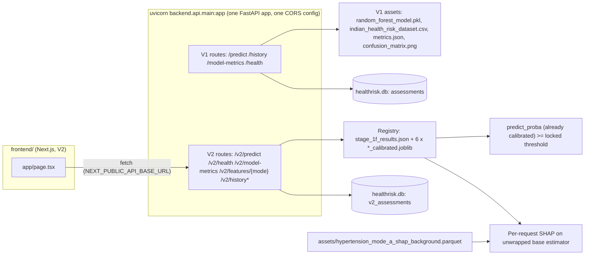

# Architecture and Project Status

> Research prototype for risk estimation and preventive screening support. Not a clinically validated diagnostic product. Status basis: Phase 2 (V2 backend) complete; V2 frontend (Phase 3) not started.

## 1. Overview

Two generations coexist in the repository:

| Generation | What it is | Status |
|---|---|---|
| **V1** | Next.js + FastAPI + SQLite web app. One Random Forest **regressor** on a small synthetic Indian dataset, outputting a universal 0–100 score with SHAP plots, rule-based insights, recommendations and history. | The V1 UI has been replaced in `frontend/` by the V2 interface; the V1 API routes remain and are verified by automated tests. |
| **V2** | Disease-specific calibrated risk models for **CVD, Diabetes and Hypertension** on **NHANES 2021–2023**, each in **Mode A** (basic information) and **Mode B** (basic + labs): six configurations. | ML pipeline frozen (Stage 1G-4: CONDITIONAL PASS). **Backend integrated and tested** (`/v2/*`, live SHAP, V2 history). **V2 frontend implemented** (Assessment, History, Model Performance); browser end-to-end verification pending. |

## 2. Objectives

1. Independent disease-specific probabilities for CVD, Diabetes, Hypertension.
2. Mode A (no labs) and Mode B (adds labs).
3. Calibrated probabilities and threshold-based screening decisions.
4. SHAP-based explanations for individual predictions, computed for the submitted input.
5. Research quality: leakage controls, fixed splits, held-out test, independent audits.

Non-goals: clinical diagnosis; a universal health score (the V1 0–100 score is not part of the V2 design and does not appear in any `/v2` response).

## 3. V1 to V2 evolution

**V1 (verified in code):** `dataset/indian_health_risk_dataset.csv` (~15.6 KB, synthetic); 14 inputs; sklearn Pipeline with RandomForestRegressor at `backend/models/random_forest_model.pkl`; score banded Low (0–34) / Medium (35–69) / High (70–100); `shap.TreeExplainer`; stored metrics in `backend/outputs/metrics.json` (MAE 11.26, RMSE 13.12, R² 0.786; accuracy 0.667, F1 0.666).

**V1 limitations:** synthetic and very small data; a universal score with no probabilistic meaning or threshold; regression on a constructed score; wearable-style inputs (HRV, SpO₂) unavailable in a survey with confirmed outcomes; no calibration, leakage control or formal held-out evaluation.

| V1 | V2 | Rationale |
|---|---|---|
| Synthetic Indian dataset | NHANES 2021–2023 | Real, documented survey with exam and lab data |
| One 0–100 score | Three disease-specific probabilities | Each disease has its own definition, prevalence and risk factors |
| One input form | Mode A / Mode B | Usable without labs (A); higher discrimination with labs (B) |
| One model | Six separately selected models | Best algorithm differed by disease and mode |
| Uncalibrated output | Sigmoid calibration + locked thresholds | Meaningful probabilities and a justified cut-off |
| Ad hoc evaluation | 70/15/15 stratified splits, held-out test, Stage 1G audits | Research-grade evidence |

## 4. Technology stack

| Layer | Technology | Source |
|---|---|---|
| Frontend | Next.js `^16.2.7` (App Router), React 18.3.1, TypeScript 5.5.4, plain global CSS | `frontend/package.json` |
| Backend API | FastAPI 0.165.0, Uvicorn 0.54.0, Pydantic 2.14.4 | `backend/requirements.txt` (all pinned) |
| Secondary UI | Streamlit 1.67.0 | `backend/api/app.py` |
| Database | SQLite via built-in `sqlite3` (no ORM, no migration tool) | `backend/database/database.py` |
| ML / inference | scikit-learn 1.9.0, XGBoost 3.4.1, SHAP 0.54.1, pandas 3.1.1, numpy 2.5.5, joblib 1.6.0, pyarrow 26.0.1 | `backend/requirements.txt` |
| Tests | pytest 9.2.0, httpx 0.28.1 | `backend/requirements-dev.txt` |

Runtime: project `.venv`, Python 3.13. scikit-learn 1.9.0 matches the version recorded in `stage_1f_results.json`; XGBoost and SHAP training versions were never recorded, so the pinned versions are the ones validated by the parity tests. The V1 pickle was trained with scikit-learn 1.8.0 and loads under 1.9.0 with a version warning.

## 5. Repository structure

```
AI-Health-Risk-Scoring-System/
├── PROJECT_SYSTEM_DESCRIPTION.md        # Original blueprint (may be outdated)
├── README.md                            # Stale V1-only readme
├── repository_cleanup_audit.md / repository_cleanup_final.md
├── shap_compute.py, shap_plot_figure3.py  # Stage 1G-3 research SHAP (repo root, frozen)
├── shap_global_values.{csv,json}, fig3_*, shap_summary_plot.png, shap_waterfall_plot.png
├── dataset/indian_health_risk_dataset.csv # V1 runtime dataset (KEEP)
├── docs/                                # All documentation (see README.md)
├── frontend/app/{page.tsx, layout.tsx, globals.css, icon.svg}   # V1 UI
└── backend/
    ├── requirements.txt, requirements-dev.txt
    ├── api/
    │   ├── api_server.py                # V1 API (unchanged)
    │   ├── app.py                       # Streamlit dashboard (V1)
    │   ├── main.py                      # Composition root: V1 app + /v2 router + V2 lifespan
    │   └── v2/                          # V2 inference engine (config, registry, preprocessing,
    │                                    #   schemas, explain, service, history, router, errors,
    │                                    #   tools/, assets/)
    ├── database/{database.py, healthrisk.db (untracked, git-ignored)}
    ├── models/random_forest_model.pkl   # V1 model (KEEP)
    ├── outputs/{metrics.json, confusion_matrix.png (V1), model_v2_baseline/, model_v2_xgboost_baseline/}
    ├── tests/                           # pytest suite (V1 non-regression + V2)
    └── ml/{*.py (V1 helpers), scripts/, data/, evaluation/{stage_1e2,stage_1e3,stage_1f,stage_1g}}   # V2 research pipeline (frozen)
```

## 6. System architecture

### Current



The Next.js frontend (see [frontend.md](frontend.md)) now consumes the V2 routes only; the V1 routes remain in the backend but no UI calls them.

### V2 request flow (implemented)

`POST /v2/predict` → Pydantic validation → `encode_inputs` (harmonizer-equivalent codes, `NaN` for absent) → per requested disease: ordered one-row frame from registry `features` → calibrated `predict_proba[0,1]` → `>= threshold` → optional live SHAP → response → (if `save_to_history`) one-transaction insert of all disease rows, degrading to a response `warnings` entry on failure.

## 7. Current implementation status

| Component | Status |
|---|---|
| NHANES data pipeline, six datasets, splits | Implemented & verified (parquet row counts 7,809 and feature order verified against `stage_1f_results.json`) |
| Model selection, calibration, locked thresholds (Stages 1D–1F) | Implemented & verified (with the test-selection caveat) |
| SHAP research validation (1G-3), research readiness (1G-4) | Implemented & verified; CONDITIONAL PASS, pipeline frozen |
| V2 model registry, preprocessing, calibrated inference | Implemented & verified (golden parity max diff 7.8e-16; full test-split metrics reproduced within 5e-5) |
| V2 live SHAP (all six configs) | Implemented & verified (additivity ≤ 2.2e-6; 3-disease Mode B p95 ≈ 261 ms) |
| V2 `/v2/predict`, `/v2/health`, `/v2/model-metrics`, `/v2/features/{mode}` | Implemented & verified (automated tests) |
| V2 persistence and `/v2/history*` | Implemented & verified (automated tests) |
| V1 FastAPI routes / SQLite `assessments` | Implemented; V1 API contract verified by tests (no frontend uses it any more) |
| Streamlit dashboard | Partially implemented (predict path broken, V1) |
| V2 frontend (Mode A/B form, three condition cards, SHAP chart, History, Model Performance) | Implemented; type-check and production build clean; API shapes checked against the live backend; **not yet browser-tested end to end** |
| Authentication / users | Not started (none planned) |
| Deployment / CI configuration | Not started |

## 8. Pending phases

| Phase | Content | Status |
|---|---|---|
| 2A–2C | V2 integration audit, backend, persistence + tests | **Done** |
| 3A–3B | V2 Next.js frontend: design system, assessment flow, History, Model Performance | **Done** (see [frontend.md](frontend.md)) |
| 4 | End-to-end verification in a browser; deployment configuration | Next |
| 5 | Retire V1 (routes, assets, `assessments`) only after the V2 UI is validated | Planned |

## 9. Repository cleanup

Per `repository_cleanup_audit.md` and `repository_cleanup_final.md`: 317 tracked files audited; six V1 docs archived to `docs/legacy_v1/`; untracked root `node_modules/`, `.next/` and `__pycache__/` removed; V2 data, splits, models, reports and V1 runtime assets preserved. Phase 2C additionally untracked `backend/database/healthrisk.db` and added `*.db` to `.gitignore`.

**Discrepancies:** the cleanup reports say `frontend/node_modules/` and `frontend/.next/` were preserved, but neither exists; run `npm install` before using the frontend. `docs/legacy_v1/` was absent from the working tree when Phase 2 began (its seven files showed as deleted in `git status`); it has not been restored.

## 10. Known limitations and risks

**Scientific:** single cross-sectional US cohort, no external validation; CVD is self-reported prevalent history, not incident risk; survey weights unused; the test set informed model-family choice (see [ml-pipeline-and-evaluation.md](ml-pipeline-and-evaluation.md)); sensitivity below 0.65 on test for CVD B and Hypertension B; SHAP is non-causal and in base-model output space; the V1 target population (Indian) differs from the NHANES training population (US).

**Engineering:** training-data encoding quirks (activity level ignores unit columns; "alcohol frequency" is a status; see [api-and-database.md](api-and-database.md) §3.2); `bmi` required although 23.5% missing in training; artifact deserialization is version-sensitive (pins matter); V1 defects remain (listed in the API doc); plaintext SQLite storage of health inputs; no authentication; CORS only allows localhost:3000.

## 11. Recommended next steps

1. Phase 4: browser end-to-end verification of all three views against the running backend; deployment configuration.
2. Disclose the test-selection caveat and unweighted metrics in any paper; fix the report inconsistencies listed in the ML doc.
3. Decide on retiring the V1 backend routes, assets and `assessments` table now that no UI uses them.

## Current project state

- **Fully complete:** V2 ML research pipeline (frozen) and the V2 backend (registry, inference, live SHAP, persistence, `/v2/*`), verified by a 126-test suite including golden parity and V1 non-regression.
- **Currently implemented:** the V2 API and the V2 Next.js frontend (Assessment, History, Model Performance); the V1 API routes remain in the backend.
- **Partially implemented:** Streamlit dashboard.
- **Not started:** authentication, deployment, V1 retirement.
- **Next task:** Phase 4, browser end-to-end verification.
