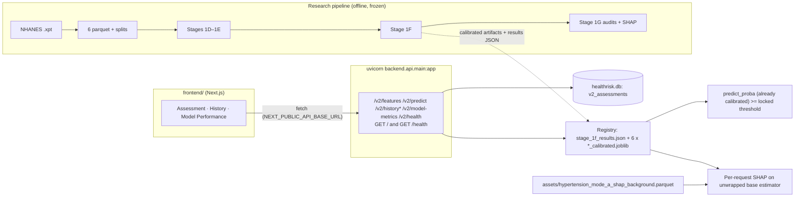

# Architecture and Project Status

> Research prototype for risk estimation and preventive screening support. Not a clinically validated diagnostic product. The repository is **V2-only**: the earlier V1 prototype was retired in Phase 5.

## 1. Overview

The system estimates, independently, the probability of **cardiovascular disease (CVD)**, **diabetes** and **hypertension** from routinely available information, using calibrated models trained on **NHANES 2021–2023** adults, and explains each estimate with live SHAP. Each condition is available in **Mode A** (profile, vitals, lifestyle) and **Mode B** (adds laboratory biomarkers): six configurations, each compared with its own locked screening threshold.

| Layer | Status |
|---|---|
| ML research pipeline (data → selection → calibration → audits) | Complete and frozen (Stage 1G-4: CONDITIONAL PASS) |
| Backend (FastAPI inference engine, live SHAP, SQLite history) | Implemented and verified by 123 automated tests |
| Frontend (Next.js: Assessment, History, Model Performance) | Implemented; type-check and production build clean; **not yet browser-tested end to end** |

## 2. Objectives

1. Independent disease-specific probabilities for CVD, Diabetes, Hypertension.
2. Mode A (no labs) and Mode B (adds labs).
3. Calibrated probabilities and threshold-based screening decisions.
4. SHAP-based explanations for individual predictions, computed for the submitted input.
5. Research quality: leakage controls, fixed splits, held-out test, independent audits.

Non-goals: clinical diagnosis; any combined or 0–100 score (none appears anywhere in the API or UI).

## 3. History: why V2 exists

The project began as a V1 prototype: a single RandomForestRegressor on a small synthetic Indian dataset producing one universal 0–100 score, with SHAP plots, rule-based insights, a Streamlit dashboard and a SQLite history. Its limits motivated the redesign: synthetic and very small data; a score with no probabilistic meaning or justified threshold; regression on a constructed target; wearable-style inputs (HRV, SpO₂) unavailable in a population survey with confirmed outcomes; no calibration, leakage control or formal held-out evaluation.

| V1 | V2 | Rationale |
|---|---|---|
| Synthetic Indian dataset | NHANES 2021–2023 | Real, documented survey with exam and lab data |
| One 0–100 score | Three disease-specific probabilities | Each disease has its own definition, prevalence and risk factors |
| One input form | Mode A / Mode B | Usable without labs (A); higher discrimination with labs (B) |
| One model | Six separately selected models | The best algorithm differed by disease and mode |
| Uncalibrated output | Sigmoid calibration + locked thresholds | Meaningful probabilities and a justified cut-off |
| Ad hoc evaluation | 70/15/15 stratified splits, held-out test, Stage 1G audits | Research-grade evidence |

V1 was removed in Phase 5 (see [api-and-database.md](api-and-database.md) §4 for exactly what was removed and what was left); its code remains in git history.

## 4. Technology stack

| Layer | Technology | Source |
|---|---|---|
| Frontend | Next.js `^16.2.7` (App Router, Turbopack), React 18.3.1, TypeScript 5.5.4, framer-motion, lucide-react | `frontend/package.json` |
| Backend API | FastAPI 0.165.0, Uvicorn 0.54.0, Pydantic 2.14.4 | `backend/requirements.txt` (all pinned) |
| Database | SQLite via built-in `sqlite3` (no ORM, no migration tool) | `backend/database/database.py` |
| ML / inference | scikit-learn 1.9.0, XGBoost 3.4.1, SHAP 0.54.1, pandas 3.1.1, numpy 2.5.5, joblib 1.6.0, pyarrow 26.0.1 | `backend/requirements.txt` |
| Research plots | matplotlib 3.11.2 (research scripts only; not used by the API) | `backend/requirements.txt` |
| Tests | pytest 9.2.0, httpx 0.28.1 | `backend/requirements-dev.txt` |

Runtime: project `.venv`, Python 3.13. scikit-learn 1.9.0 matches the version recorded in `stage_1f_results.json`; XGBoost and SHAP training versions were never recorded, so the pinned versions are the ones validated by the parity tests.

## 5. Repository structure

```
AI-Health-Risk-Scoring-System/
├── README.md
├── docs/                                  # all documentation (see docs/README.md)
├── frontend/                              # Next.js interface (app/, components/, lib/)
└── backend/
    ├── requirements.txt, requirements-dev.txt
    ├── api/
    │   ├── main.py                        # FastAPI app: lifespan, CORS, /, /health, /v2 router
    │   └── v2/                            # config, registry, preprocessing, schemas, explain,
    │                                      #   service, history, router, errors, tools/, assets/
    ├── database/                          # database.py (v2_assessments); healthrisk.db is git-ignored
    ├── outputs/model_v2_baseline/, model_v2_xgboost_baseline/   # Stage 1D / 1E-1 outputs
    ├── tests/                             # pytest suite
    └── ml/                                # frozen research pipeline
        ├── scripts/                       # Stages 1A–1F (data build, benchmarks, optimization, calibration)
        ├── data/                          # raw, interim, processed NHANES + splits
        └── evaluation/                    # stage_1e2, stage_1e3, stage_1f (final models), stage_1g
                                           #   (audits, SHAP scripts, shap_global_values.*, figures/)
```

## 6. System architecture



### Request flow

`POST /v2/predict` → Pydantic validation → `encode_inputs` (harmonizer-equivalent codes, `NaN` for absent) → per requested disease: ordered one-row frame from registry `features` → calibrated `predict_proba[0,1]` → `>= threshold` → optional live SHAP → response → (if `save_to_history`) one-transaction insert of all disease rows, degrading to a response `warnings` entry on failure.

## 7. Current implementation status

| Component | Status |
|---|---|
| NHANES data pipeline, six datasets, splits | Implemented & verified (parquet row counts 7,809; feature order matches `stage_1f_results.json`) |
| Model selection, calibration, locked thresholds (Stages 1D–1F) | Implemented & verified (with the test-selection caveat) |
| SHAP research validation (1G-3), research readiness (1G-4) | Implemented & verified; CONDITIONAL PASS, pipeline frozen |
| V2 registry, preprocessing, calibrated inference | Implemented & verified (golden parity max diff 7.8e-16; full test-split metrics reproduced within 5e-5) |
| V2 live SHAP (all six configs) | Implemented & verified (additivity ≤ 2.2e-6; 3-disease Mode B p95 ≈ 261 ms) |
| `/v2/predict`, `/v2/health`, `/v2/model-metrics`, `/v2/features/{mode}`, `/v2/history*` | Implemented & verified (automated tests) |
| Frontend (Mode A/B form, three condition cards, SHAP chart, History, Model Performance) | Implemented; type-check and production build clean; API shapes checked against the live backend; **not yet browser-tested end to end** |
| `backend/ml/scripts/main.py` (V1 end-to-end runner) | Orphaned: imports deleted V1 helpers; left in place pending approval to delete |
| Authentication / users | Not started (none planned) |
| Deployment / CI configuration | Not started |

## 8. Phases

| Phase | Content | Status |
|---|---|---|
| 1 | NHANES pipeline, model selection, calibration, audits | Done (frozen) |
| 2A–2C | V2 integration audit, backend, persistence + tests | Done |
| 3A–3C | Next.js frontend: design system, assessment, History, Model Performance, light redesign | Done |
| 4 | Browser end-to-end verification; deployment configuration | Next |
| 5 | V1 retirement and V2-only repository | Done |

## 9. Repository history notes

- Phase 5 deleted: `backend/api/api_server.py`, `backend/api/app.py`, `dataset/`, `backend/models/`, V1 outputs, the ten V1 helper modules in `backend/ml/`, V1 database functions and tests, and the superseded monolithic documents (`PROJECT_SYSTEM_DESCRIPTION.md`, `repository_cleanup_audit.md`, `repository_cleanup_final.md`, the comprehensive summary snapshot).
- Root-level Stage 1G-3 SHAP assets were consolidated into `backend/ml/evaluation/stage_1g/`: three PNGs were byte-identical duplicates of files in `figures/` and were deleted; the two scripts, `shap_global_values.csv/.json` and the PDF/SVG figure were moved. The two scripts' path constants (only) were updated so they still resolve inputs from the repository root and write outputs beside themselves.
- `docs/legacy_v1/` (archived V1 documents) was already absent from the working tree before Phase 5 and has not been restored.
- Frontend `node_modules/` and `.next/` are regenerable (`npm install`).

## 10. Known limitations and risks

**Scientific:** single cross-sectional US cohort, no external validation; CVD is self-reported prevalent history, not incident risk; survey weights unused; the test set informed model-family choice (see [ml-pipeline-and-evaluation.md](ml-pipeline-and-evaluation.md)); sensitivity below 0.65 on test for CVD B and Hypertension B; SHAP is non-causal and in base-model output space.

**Engineering:** training-data encoding quirks (activity level ignores unit columns; "alcohol frequency" is a status; see [api-and-database.md](api-and-database.md) §3.2); `bmi` required although 23.5% missing in training; artifact deserialization is version-sensitive (pins matter); plaintext SQLite storage of health inputs; no authentication; CORS only allows localhost:3000.

## 11. Recommended next steps

1. Phase 4: browser end-to-end verification of all three views against the running backend; deployment configuration.
2. Decide whether to delete the orphaned `backend/ml/scripts/main.py`.
3. Disclose the test-selection caveat and unweighted metrics in any paper; fix the report inconsistencies listed in the ML doc.

## Current project state

- **Fully complete:** ML research pipeline (frozen), V2 backend (verified by 123 tests), frontend implementation, V1 retirement.
- **Partially complete:** frontend verification (type-check and build only; no browser pass).
- **Not started:** authentication, deployment, CI.
- **Next task:** Phase 4, browser end-to-end verification.